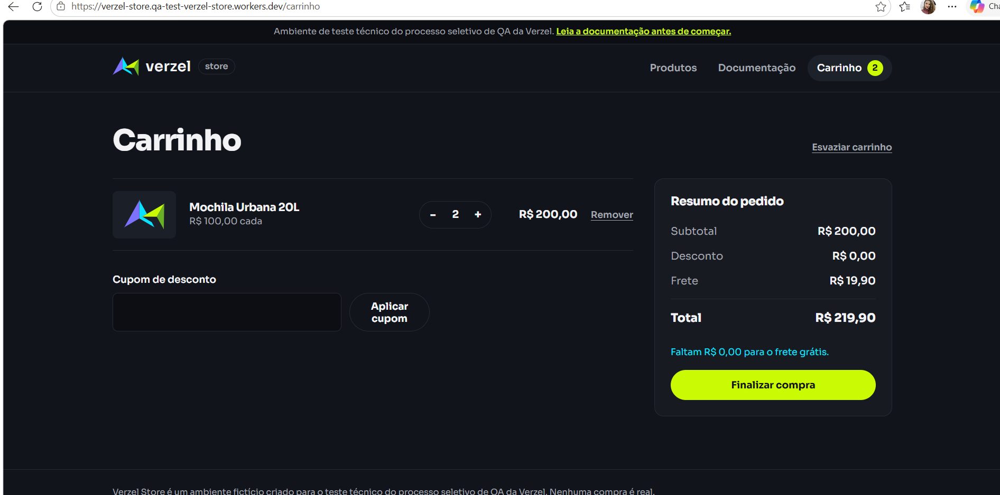
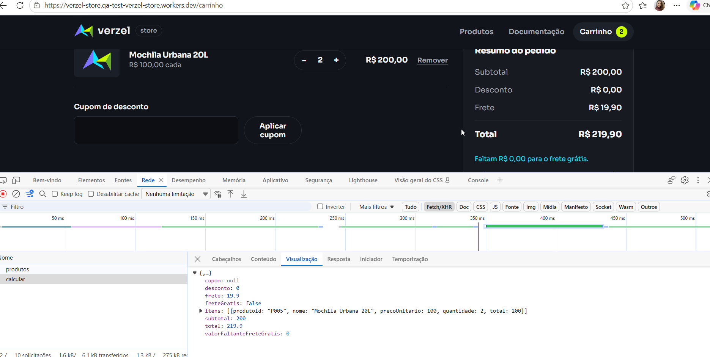

# BUG-01 · Subtotal de exatamente R$ 200,00 não recebe frete grátis

| Campo            | Valor                                                                                                    |
|------------------|----------------------------------------------------------------------------------------------------------|
| Card             | VZS-142 · Cupom de desconto e frete grátis · v2.3.0                                                      |
| Critério violado | **CA06**: "O frete é grátis para compras com subtotal a partir de R$ 200,00, **inclusive**."             |
| Severidade       | Alta                                                                                                     |
| Prioridade       | Alta                                                                                                     |
| Frequência       | Sempre (100%)                                                                                            |
| Onde ocorre      | API (`POST /api/carrinho/calcular` e `POST /api/pedidos`) e interface (carrinho, checkout e confirmação) |
| Ambiente         | https://verzel-store.qa-test-verzel-store.workers.dev · Microsoft Edge · Postman                         |
| Data             | 06/10/2026 (automação) · confirmado na execução manual em 07/10/2026                                     |
| Status           | Aberto                                                                                                   |

## Pré-condições
- Carrinho vazio e sem cupom aplicado.

## Passos para reproduzir

**Interface**
1. Na vitrine, adicionar 2 unidades de **Mochila Urbana 20L** (R$ 100,00 cada).
2. Acessar o **Carrinho**.
3. Observar o resumo do pedido.

**API**
```http
POST /api/carrinho/calcular
Content-Type: application/json

{ "itens": [{ "produtoId": "P005", "quantidade": 2 }] }
```

## Resultado esperado
- Frete **Grátis** e total de **R$ 200,00**.
- Sem a mensagem "Faltam … para o frete grátis".
- Na API: `"frete": 0`, `"freteGratis": true`, `"total": 200`.

## Resultado obtido
- Frete de **R$ 19,90** e total de **R$ 219,90**.
- A loja exibe "Faltam **R$ 0,00** para o frete grátis", o que contradiz a cobrança.
- Na API:
  ```json
  { "subtotal": 200, "frete": 19.9, "freteGratis": false, "valorFaltanteFreteGratis": 0, "total": 219.9 }
  ```
- O pedido é confirmado (201) com o frete cobrado.

## Valores-limite verificados

| Subtotal      | Frete esperado | Frete obtido | Situação |
|---------------|----------------|--------------|----------|
| R$ 199,90     | R$ 19,90       | R$ 19,90     | ✅       |
| **R$ 200,00** | **Grátis**     | **R$ 19,90** | ❌       |
| R$ 229,90     | Grátis         | Grátis       | ✅       |

## Impacto
- O cliente paga R$ 19,90 a mais em toda compra de exatamente R$ 200,00.
- Contradiz a promoção anunciada na página inicial ("Frete grátis a partir de R$ 200,00").

## Causa provável
A comparação do frete usa `subtotal > 200` em vez de `subtotal >= 200`. O cálculo do valor que falta está correto (200 − 200 = 0), por isso a mensagem e a cobrança se contradizem.

## Evidências
- Interface: [CTM-13](../evidencias/manual-ui/CTM-13_frete-exatamente-200) (tela e resposta da API no DevTools)
- API: [CTA-10 (carrinho)](../evidencias/manual-api/CTA-10_frete-exatamente-200) · [CTA-28 (pedido)](../evidencias/manual-api/CTA-28_pedido-frete-200)
- Automação: CT-06 em [`frete.spec.ts`](../../automacao/tests/e2e/frete.spec.ts) · [relatório](../evidencias/automacao/02_ct-06-bug-01-reproduzido.png)




