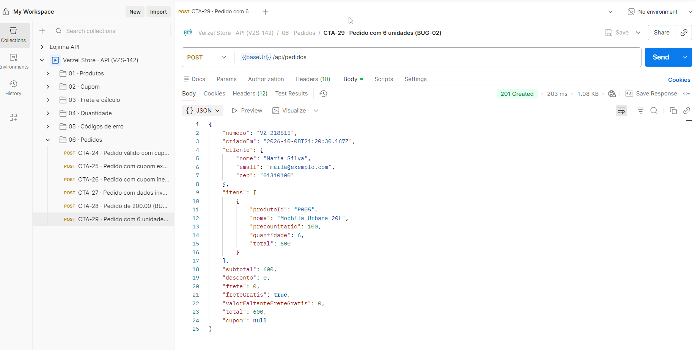

# BUG-02 · API aceita mais de 5 unidades do mesmo produto

| Campo            | Valor                                                                                                              |
|------------------|--------------------------------------------------------------------------------------------------------------------|
| Card             | VZS-142 · Cupom de desconto e frete grátis · v2.3.0                                                                |
| Critério violado | **CA10**: "Cada produto pode ter no máximo 5 unidades por pedido. A regra vale para a interface **e para a API**." |
| Severidade       | Alta                                                                                                               |
| Prioridade       | Média                                                                                                              |
| Frequência       | Sempre (100%)                                                                                                      |
| Onde ocorre      | API (`POST /api/carrinho/calcular` e `POST /api/pedidos`). A interface bloqueia corretamente.                      |
| Ambiente         | https://verzel-store.qa-test-verzel-store.workers.dev · Postman                                                    |
| Data             | 06/10/2026 (automação) · confirmado na execução manual em 08/10/2026                                               |
| Status           | Aberto                                                                                                             |

## Pré-condições
- Acesso direto à API (Postman, curl ou outra integração). Pela interface não é possível reproduzir.

## Passos para reproduzir

**Cálculo do carrinho**
```http
POST /api/carrinho/calcular
Content-Type: application/json

{ "itens": [{ "produtoId": "P001", "quantidade": 6 }] }
```

**Confirmação do pedido**
```http
POST /api/pedidos
Content-Type: application/json

{
  "cliente": { "nome": "Maria Silva", "email": "maria@exemplo.com", "cep": "01310-100" },
  "itens": [{ "produtoId": "P005", "quantidade": 6 }]
}
```

## Resultado esperado
Status **422** com o erro previsto na tabela "Códigos de erro" da documentação:
```json
{ "erro": { "codigo": "QUANTIDADE_MAXIMA_EXCEDIDA", "mensagem": "...", "campo": "itens[0].quantidade" } }
```

## Resultado obtido

| Requisição                          | Status  | Resposta                                                      |
|-------------------------------------|---------|---------------------------------------------------------------|
| Carrinho com 6 Camisetas            | **200** | Calculado normalmente: `"quantidade": 6`, `"subtotal": 359.4` |
| Pedido com 6 Mochilas               | **201** | Pedido confirmado: `"numero": "VZ-218615"`, `"total": 600`    |
| Carrinho com 1.000.000 de Camisetas | **200** | `"subtotal": 59900000` (R$ 59.900.000,00)                     |

O código `QUANTIDADE_MAXIMA_EXCEDIDA` nunca é retornado. Já o limite mínimo funciona: quantidade 0, negativa ou decimal retorna `QUANTIDADE_INVALIDA` (CTA-20).

## Impacto
- Qualquer chamada direta à API cria pedidos fora da regra de negócio, sem nenhum limite de quantidade.
- A regra fica protegida apenas no navegador, que pode ser contornado.
- Prioridade Média porque o cliente que usa a interface não chega ao problema.

## Causa provável
O limite de 5 unidades foi implementado só na interface. A API valida o mínimo (inteiro ≥ 1), mas não o máximo.

## Evidências
- API: [CTA-15 (carrinho)](../evidencias/manual-api/CTA-15_quantidade-6) · [CTA-29 (pedido)](../evidencias/manual-api/CTA-29_pedido-quantidade-6)
- Exploratório: [EXP-16 (1.000.000 de unidades)](../evidencias/exploratorio/EXP-16_api-quantidade-1000000)
- Interface bloqueando corretamente: [CTM-19](../evidencias/manual-ui/CTM-19_limite-5-na-vitrine) · [CTM-20](../evidencias/manual-ui/CTM-20_limite-5-no-carrinho)
- Automação: CT-12 em [`carrinho.spec.ts`](../../automacao/tests/api/carrinho.spec.ts)


